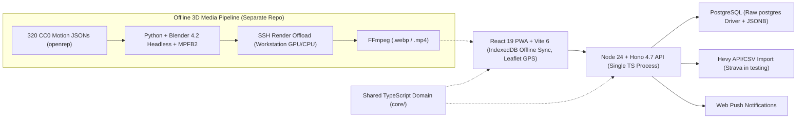

# Skorp Fit

[Português](#versao-em-portugues) | [English](#english-version)

> **Aviso de código privado:** Este repositório é a vitrine pública de arquitetura do Skorp Fit. O código-fonte é privado por ser um produto próprio em uso real. Demonstração ao vivo sob pedido: [antonymsandrade@gmail.com](mailto:antonymsandrade@gmail.com) ou [LinkedIn](https://www.linkedin.com/in/antonyandrade01/).
>
> **Private repository notice:** This repository is the public architecture showcase for Skorp Fit. Source code is private as a proprietary product in active use. Live demos are available on request: [antonymsandrade@gmail.com](mailto:antonymsandrade@gmail.com) or [LinkedIn](https://www.linkedin.com/in/antonyandrade01/).

**No ar / Live:** [gym.antonyandrade.com.br](https://gym.antonyandrade.com.br) (app no ar; pede login / live app; requires login). Acesso de demonstração sob pedido / Demo access on request.

---

## Arquitetura / Architecture

---

## Versão em Português

### Problema que resolve

Apps comerciais de musculação e cardio cobram assinaturas caras para liberar rotinas ilimitadas, histórico completo, desafios em grupo e animações de exercícios, além de falharem dentro de academias com sinal móvel instável. O Skorp Fit substitui essas ferramentas com um PWA offline-first de registro de treinos, cardio com GPS ao vivo, rankings em grupo e biblioteca própria de animações 3D sem dependência de mídia proprietária.

### Números reais

- Em produção, em uso por usuários reais.
- Inclui pipeline separado de renderização 3D cobrindo 320 movimentos de exercícios em JSON sob licença CC0, gerando cerca de 21 exercícios completos em ~13 minutos na workstation via SSH (cerca de 8x mais rápido que no servidor sem GPU).

### Decisões técnicas e trade-offs

#### Processo único em Node 24 com Hono e núcleo TypeScript compartilhado

Um único processo Node 24 serve a API REST em Hono 4.7 e o bundle estático do PWA em React 19 + Vite 6. O backend usa o type stripping nativo do Node 24, rodando arquivos `.ts` diretamente sem etapa de compilação no servidor. A pasta `core/` concentra as regras de treino, cálculo de progressão, conquistas, desafios, filtro de GPS (`FiltroGps`) e parser GPX/Hevy, rodando tanto no navegador quanto no servidor.

Trade-off: simplifica deploy e elimina divergência de validação entre cliente e API, mas acopla o ciclo de reinício do servidor estático ao da API. Para o volume atual e de pequenas comunidades, a simplicidade operacional compensa.

#### PostgreSQL com driver direto e JSONB para séries de treino

O backend usa o driver `postgres` com SQL parametrizado em vez de um ORM pesado. Usuários, sessões, grupos, desafios, notificações e trilhas GPS ficam em tabelas relacionais, enquanto os exercícios e séries de cada treino ficam em colunas `jsonb`. Na gravação de cardio ao vivo, o estado sobrevive a recarregamentos da página via IndexedDB com `Screen Wake Lock`, descarta pontos GPS com precisão pior que 35 metros e simplifica trilhas acima de ~2 MB antes de gravar no banco.

Trade-off: ler e sincronizar um treino inteiro offline vira uma única escrita transacional sem dezenas de joins, mas consultas analíticas por série individual exigem expansão de JSONB. A evolução de schema hoje roda por `CREATE TABLE IF NOT EXISTS` / `ALTER TABLE` no boot (`server/db.ts`); para abrir o produto a terceiros em escala, o próximo passo é adotar migrations versionadas.

#### Separação de licenças na fábrica de mídia 3D

As animações 3D dos exercícios são geradas fora do app usando Blender 4.2.3 LTS headless, extensão MakeHuman MPFB2 (modelos CC0), movimentos em JSON CC0 (`openrep`) e FFmpeg. Os scripts Python que controlam o Blender ficam em pasta separada com licença GPL-3.0, e o aplicativo recebe apenas os arquivos `.webp`/`.mp4` finais (que não herdam GPL). Um script dispara a renderização por SSH na workstation com 14 núcleos e GPU quando ela está ligada, com fallback no servidor Linux.

Trade-off: manter dois repositórios/pastas e um passo manual de aprovação visual adiciona etapa operacional, mas elimina qualquer risco de licença GPL contaminar o código do app e evita custo recorrente com bibliotecas pagas de vídeo.

### Em produção vs. em teste

Em produção:
- Registro completo de treinos de força offline-first com cronômetro de descanso, recordes pessoais, fotos reduzidas no aparelho e medidas corporais.
- Gravação de cardio ao vivo com mapa Leaflet, filtro de precisão GPS, parciais por quilômetro, importação GPX e sincronização com Hevy (CSV e chave API cifrada por usuário).
- Grupos de treino, feed social, reações, comentários, desafios com período/meta, notificações Web Push e painel administrativo.

Em teste / pendente de ativação externa:
- Integração OAuth2 com o Strava (implementada no código e dependente das credenciais de app do Strava para ativação pública).
- Empacotamento em APK nativo para gravação GPS em segundo plano no Android.
- Renderização em lote do catálogo completo de 320 animações 3D (os exercícios ativos do treino já foram gerados e validados).

---

## English Version

### Problem it solves

Commercial gym and cardio apps lock unlimited routines, full history, group challenges, and exercise animations behind monthly paywalls, and often break inside gyms with poor mobile signal. Skorp Fit replaces them with an offline-first PWA for strength logging, live GPS cardio tracking, group leaderboards, and an in-house 3D exercise animation library.

### Real numbers

- Running in production with real users.
- Backed by a separate 3D rendering pipeline covering 320 CC0 exercise motion JSONs, rendering a 21-exercise workout batch in ~13 minutes via SSH offload to a desktop workstation (~8x faster than CPU-only server rendering).

### Technical decisions and trade-offs

#### Single Node 24 + Hono process with shared TypeScript domain logic

One Node 24 process serves both the Hono 4.7 REST API and the static React 19 + Vite 6 PWA bundle. Node 24 native type stripping runs `.ts` files directly without a backend build step. A shared `core/` folder holds workout progression rules, achievements, challenges, GPS filtering (`FiltroGps`), and GPX/Hevy parsers so browser and server execute identical validation logic.

Trade-off: deployment stays minimal and avoids client/server rule drift, at the cost of coupling static asset serving and API restarts. For small communities, operational simplicity outweighs splitting services.

#### Raw PostgreSQL driver with JSONB workout documents

The API talks to PostgreSQL through the `postgres` driver with parameterized SQL instead of an ORM. Users, sessions, groups, challenges, notifications, and GPS tracks live in relational tables, while workout exercises and sets are stored as `jsonb`. Live cardio recording persists state to IndexedDB every few seconds with `Screen Wake Lock`, discards GPS fixes worse than 35 m accuracy, and simplifies tracks larger than ~2 MB before saving.

Trade-off: syncing an entire offline workout becomes a single atomic write without multi-table joins, while deep per-set analytics require JSONB unpacking. Schema updates currently run as idempotent `CREATE/ALTER` statements at startup (`server/db.ts`); moving to versioned migrations is the next step before broader rollout.

#### License isolation for the headless 3D media pipeline

Exercise animations are rendered outside the app using headless Blender 4.2.3 LTS, MakeHuman MPFB2 (CC0 meshes), CC0 motion JSONs (`openrep`), and FFmpeg. Because Blender Python scripts carry GPL-3.0 obligations, they stay isolated from the application repo; the app only consumes rendered `.webp`/`.mp4` outputs. A shell wrapper offloads rendering over SSH to a 14-core desktop when online, falling back to the Linux server.

Trade-off: keeping media generation outside the app adds a manual batch-approval step, but prevents GPL contamination and removes recurring media licensing costs.

### Production vs. in testing

In production:
- Offline-first strength logging with rest timers, personal records, client-compressed check-in photos, and body measurements.
- Live GPS cardio tracking with Leaflet maps, accuracy filtering, per-km splits, GPX import, and Hevy CSV/API sync (per-user encrypted keys).
- Training groups, social feed, reactions, comments, custom challenges, Web Push notifications, and admin tools.

In testing / pending external activation:
- Strava OAuth2 import (implemented in code, awaiting public Strava app credentials).
- Native Android APK wrapper for background GPS recording.
- Full-catalog batch rendering of all 320 3D animations (active training routines are already rendered and verified).
