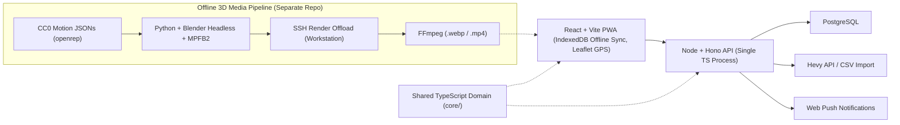

# Skorp Fit

[Português](#versao-em-portugues) | [English](#english-version)

> **Aviso de código privado:** Este repositório é a vitrine pública de arquitetura do Skorp Fit. O código-fonte é privado por ser um produto próprio em uso no dia a dia. Demonstração ao vivo sob pedido: [antonymsandrade@gmail.com](mailto:antonymsandrade@gmail.com) ou [LinkedIn](https://www.linkedin.com/in/antonyandrade01/).
>
> **Private repository notice:** This repository is the public architecture showcase for Skorp Fit. Source code is private as a proprietary product in daily use. Live demos are available on request: [antonymsandrade@gmail.com](mailto:antonymsandrade@gmail.com) or [LinkedIn](https://www.linkedin.com/in/antonyandrade01/).

**No ar / Live:** [gym.antonyandrade.com.br](https://gym.antonyandrade.com.br) (app no ar; pede login / live app; requires login). Acesso de demonstração sob pedido / Demo access on request.

---

## Arquitetura / Architecture

---

## Versão em Português

### Problema que resolve

Apps comerciais de musculação e cardio costumam cobrar assinaturas para liberar rotinas, histórico completo e desafios em grupo, além de falharem dentro de academias com sinal móvel instável. O Skorp Fit funciona como um PWA offline-first de registro de treinos, cardio com GPS ao vivo, rankings em grupo e biblioteca própria de animações 3D.

### Decisões técnicas e trade-offs

#### Processo único em Node com Hono e núcleo TypeScript compartilhado

Um único processo Node serve a API REST em Hono e os arquivos estáticos do PWA em React e Vite, rodando arquivos `.ts` diretamente sem etapa separada de compilação no servidor. A pasta `core/` reúne as regras de treino, cálculo de progressão, conquistas, desafios, filtro de GPS e leitura de arquivos GPX/Hevy, rodando tanto no navegador quanto no servidor.

Trade-off: simplifica o deploy e evita que cliente e API calculem regras diferentes, mas reinicia o servidor estático junto com a API. Para comunidades pequenas, a simplicidade operacional compensa.

#### PostgreSQL direto e IndexedDB para treinos offline

O backend usa SQL parametrizado direto com o driver `postgres` em vez de um ORM. Contas, sessões, grupos, desafios e trilhas GPS ficam em tabelas relacionais, enquanto exercícios e séries de cada treino ficam em `jsonb`. Na gravação de cardio ao vivo, o estado é salvo no IndexedDB com bloqueio de tela ativa, descarta pontos GPS com precisão pior que 35 metros e simplifica trilhas acima de ~2 MB antes de enviar.

Trade-off: sincronizar um treino gravado offline vira uma única escrita no banco sem dezenas de joins, mas análises detalhadas por série exigem abrir o JSON. Hoje as tabelas são atualizadas na inicialização do servidor; migrations versionadas ficam para uma etapa futura.

#### Separação de licenças na geração de mídia 3D

As animações 3D dos exercícios são geradas fora do app usando Blender headless, modelos humanos CC0 (MPFB2), movimentos em JSON CC0 (`openrep`) e FFmpeg. Como scripts Python do Blender carregam obrigações da licença GPL-3.0, eles ficam em um projeto separado, e o app recebe apenas os arquivos `.webp` e `.mp4` finais. Quando a workstation com GPU está ligada, a renderização roda nela via SSH (~13 minutos para um lote de exercícios, cerca de 8x mais rápido do que no servidor sem GPU).

Trade-off: gera uma etapa manual de aprovação visual das mídias geradas, mas elimina risco de licença GPL no app e evita custo recorrente com bibliotecas pagas de vídeo.

### O que está no ar

- App no ar e em uso no dia a dia em [gym.antonyandrade.com.br](https://gym.antonyandrade.com.br).
- Registro de treinos de força offline-first com cronômetro de descanso, recordes pessoais, fotos reduzidas no aparelho e medidas corporais.
- Gravação de cardio ao vivo com mapa Leaflet, filtro de precisão GPS, parciais por quilômetro, importação GPX e sincronização com Hevy (CSV e chave API cifrada por conta).
- Grupos de treino, feed social, reações, comentários, desafios com período e meta, notificações Web Push e painel administrativo.

---

## English Version

### Problem it solves

Commercial gym and cardio apps often lock unlimited routines, full history, and group challenges behind monthly paywalls, and fail inside gyms with poor mobile signal. Skorp Fit is an offline-first PWA for strength logging, live GPS cardio tracking, group leaderboards, and an in-house 3D exercise animation library.

### Technical decisions and trade-offs

#### Single Node + Hono process with shared TypeScript domain logic

One Node process serves both the Hono REST API and the static React + Vite PWA bundle, running `.ts` files directly without a backend build step. A shared `core/` folder holds progression rules, achievements, challenges, GPS filtering, and GPX/Hevy parsers so browser and server execute identical logic.

Trade-off: deployment stays simple and avoids client/server rule drift, at the cost of restarting static asset serving alongside the API. For small training groups, operational simplicity outweighs splitting services.

#### Raw PostgreSQL driver and IndexedDB for offline workouts

The API talks to PostgreSQL with parameterized SQL instead of an ORM. Accounts, sessions, groups, challenges, and GPS tracks live in relational tables, while workout exercises and sets are stored as `jsonb`. Live cardio recording saves state to IndexedDB with `Screen Wake Lock`, discards GPS fixes worse than 35 m accuracy, and simplifies tracks larger than ~2 MB before saving.

Trade-off: syncing an offline workout becomes a single atomic write without multi-table joins, while per-set analytics require unpacking JSONB. Schema updates currently run at startup; versioned migrations remain a future step.

#### License isolation for the headless 3D media pipeline

Exercise animations are rendered outside the app using headless Blender, MakeHuman MPFB2 (CC0 meshes), CC0 motion JSONs (`openrep`), and FFmpeg. Because Blender Python scripts carry GPL-3.0 obligations, they stay in a separate repository and the app only consumes rendered `.webp` and `.mp4` files. When the GPU workstation is online, rendering offloads over SSH (~13 minutes per workout batch, roughly 8x faster than CPU-only server rendering).

Trade-off: keeping media generation separate adds a manual visual approval step, but avoids GPL contamination in the app and removes recurring media licensing costs.

### What is live

- Live app in daily use at [gym.antonyandrade.com.br](https://gym.antonyandrade.com.br).
- Offline-first strength logging with rest timers, personal records, client-compressed check-in photos, and body measurements.
- Live GPS cardio tracking with Leaflet maps, accuracy filtering, per-km splits, GPX import, and Hevy CSV/API sync (per-account encrypted keys).
- Training groups, social feed, reactions, comments, custom challenges, Web Push notifications, and admin tools.
